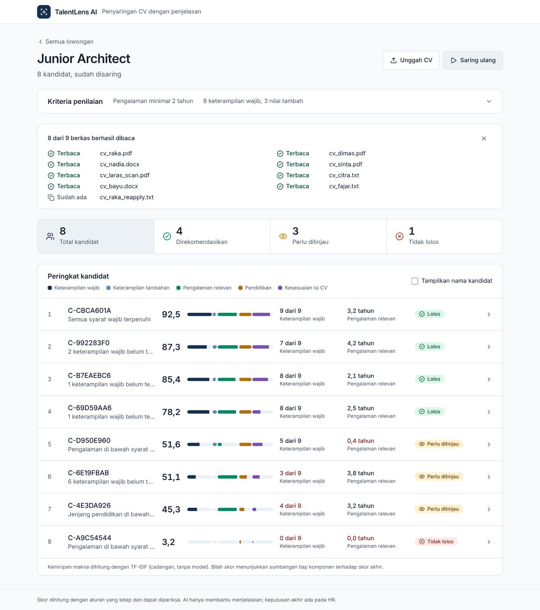

# TalentLens AI

AI Recruitment Copilot: Proof of Concept yang menyaring dan memeringkat CV terhadap sebuah
lowongan, lengkap dengan skor, alasan, bukti dari CV, dan ringkasan untuk HR.

**Status: Sprint 4 (siap demo).** Alur dari unggah lowongan sampai catatan recruiter berjalan
dan teruji, dengan penjelasan skor, rincian kecocokan, dan penanda kata kunci pada CV. Model
embedding E5 dan Gemini sudah terbukti berjalan di mesin Product Owner. Yang masih terbuka ada di
[Yang sudah diverifikasi dan yang belum](#yang-sudah-diverifikasi-dan-yang-belum).



## Alur

```
Lowongan (PDF/DOCX/TXT) ─> parser lowongan ─> kriteria
CV (PDF/DOCX/TXT/scan)  ─> parser CV ─> Candidate JSON (data pribadi dipisahkan)
        │
        └─> embedding ─> indeks FAISS ─> kemiripan semantik ─> skor berbobot ─> peringkat
                                                                    │
                                              ringkasan HR (Gemini) ┘  hanya menjelaskan, tidak menilai
```

Skor dihitung secara deterministik dari empat komponen: keterampilan (35%), pengalaman relevan (25%),
kesesuaian semantik (25%), dan pendidikan (15%). Rinciannya ada di [docs/SCREENING.md](docs/SCREENING.md).

## Mulai cepat

```bash
# Terminal 1: backend
cd backend
python3.12 -m venv .venv && source .venv/bin/activate  # butuh Python 3.11+; Windows: .venv\Scripts\activate
pip install -r requirements-dev.txt
pip install -r requirements-e5.txt                    # opsional: model embedding E5 (+2 GB)
uvicorn app.main:app --reload

# Terminal 2: frontend
cd frontend
npm install
npm run dev
```

Buka http://localhost:3000, lalu:

1. Unggah deskripsi lowongan.
2. Unggah CV (boleh beberapa berkas sekaligus).
3. Klik **Jalankan screening**.
4. Buka seorang kandidat untuk melihat asal skor, kecocokan per syarat, bukti dari CV, dan **Catatan recruiter**.

Dengan Docker: `docker compose up --build` (tambahkan `INSTALL_E5=true` di `.env` untuk menyertakan E5).

| Apa | Alamat |
| --- | --- |
| Antarmuka | http://localhost:3000 |
| Swagger UI | http://localhost:8000/docs |
| Health check | http://localhost:8000/api/v1/health |

## Mengaktifkan komponen AI

| Komponen | Cara mengaktifkan | Tanpa itu |
| --- | --- | --- |
| Embedding `multilingual-e5-small` | `pip install -r requirements-e5.txt`; unduhan model sekitar 470 MB saat pertama dipakai | Otomatis memakai TF-IDF (lemah untuk CV Indonesia terhadap lowongan Inggris) |
| Catatan recruiter oleh Gemini | Isi `GEMINI_API_KEY` di `backend/.env` (kunci dari Google AI Studio) | Catatan ditulis templat bawaan dengan susunan yang sama, dan diberi label sumbernya |
| OCR untuk CV hasil scan | Pasang Tesseract (`brew install tesseract tesseract-lang` atau `apt install tesseract-ocr tesseract-ocr-ind`) | CV hasil scan ditolak dengan pesan galat |

Periksa keduanya sebelum demo:

```bash
cd backend && python scripts/check_ai_backends.py
```

Skrip ini memuat model E5, membandingkan satu syarat berbahasa Inggris dengan baris CV berbahasa
Indonesia, dan memanggil Gemini satu kali. Antarmuka selalu menampilkan backend embedding yang
benar-benar dipakai dan sumber setiap ringkasan.

## Data demo dan data pribadi

- Repositori ini publik. **Jangan pernah meng-commit CV asli atau dokumen perusahaan.**
- CV diunggah lewat antarmuka. Berkasnya tidak disimpan; yang disimpan hanya hasil parsing di
  `backend/storage/state.json`, yang sudah masuk `.gitignore`.
- CV di `backend/tests/fixtures/` seluruhnya sintetis (nama dan data fiktif) dan hanya dipakai oleh tes.
- Di peringkat, kandidat tampil sebagai ID. Nama baru terlihat bila "Tampilkan identitas kandidat" dicentang.
- Ke Gemini hanya dikirim fakta hasil hitung (skor, keterampilan, alasan, kutipan CV yang sudah disamarkan). Nama, kontak, dan atribut pribadi tidak dikirim.

## Struktur

```
talentlens-ai/
├── backend/
│   ├── app/
│   │   ├── main.py             perakitan aplikasi
│   │   ├── core/               config.py, logging.py
│   │   ├── api/v1/             health.py, cvs.py, jobs.py, uploads.py, router.py
│   │   ├── schemas/            cv.py, screening.py, health.py
│   │   └── services/
│   │       ├── cv_parsing/     baca dokumen, redaksi data pribadi, ekstraksi
│   │       ├── jd_parsing.py   lowongan menjadi kriteria
│   │       ├── taxonomy.py     normalisasi keterampilan
│   │       ├── embedding.py    E5 dan TF-IDF di balik satu antarmuka
│   │       ├── vector_index.py indeks FAISS
│   │       ├── matching.py     kemiripan semantik dan skor berbobot
│   │       ├── explanation.py  aturan keputusan dan alasan
│   │       ├── match_breakdown.py  tampilan penjelasan skor (tidak ikut menilai)
│   │       ├── hr_summary.py   catatan recruiter lewat Gemini atau templat
│   │       ├── store.py        penyimpanan JSON
│   │       └── screening.py    orkestrasi pipeline
│   ├── data/taxonomy/          keterampilan dan glosarium Indonesia-Inggris
│   ├── scripts/                check_ai_backends.py
│   └── tests/                  89 tes + fixtures sintetis
├── frontend/src/
│   ├── app/                    /, /jobs/[jobId], /jobs/[jobId]/candidates/[candidateId]
│   ├── components/             komponen fitur; ui/ berisi komponen dasar
│   ├── hooks/                  use-api.ts
│   └── lib/                    api.ts, labels.ts, utils.ts
├── docs/                       arsitektur, panduan, TDR, laporan sprint
└── docker-compose.yml
```

## Environment variables

Semua punya nilai default. Untuk menjalankan tanpa Docker, letakkan di `backend/.env`
(dan `NEXT_PUBLIC_API_URL` di `frontend/.env.local`); untuk Docker Compose, di `.env` pada akar proyek.

| Variabel | Default | Fungsi |
| --- | --- | --- |
| `EMBEDDING_BACKEND` | `auto` | `auto` = E5 bila bisa dimuat, selain itu TF-IDF; `e5` = wajib E5; `tfidf` = selalu TF-IDF |
| `GEMINI_API_KEY` | kosong | Kunci Google AI Studio untuk ringkasan HR |
| `GEMINI_MODEL` | `gemini-3.6-flash` | Nama model Gemini; ganti bila tidak tersedia untuk kunci Anda |
| `SHORTLIST_THRESHOLD` | `70` | Skor minimal untuk "Lolos" |
| `REJECT_THRESHOLD` | `45` | Skor di bawah ini "Tidak lolos" |
| `REFERENCE_DATE` | kosong | Tanggal acuan masa kerja "sampai sekarang"; kosong berarti hari ini |
| `MAX_UPLOAD_MB` | `5` | Batas ukuran unggahan |
| `CORS_ORIGINS` | `http://localhost:3000` | Asal frontend yang diizinkan |
| `APP_ENV`, `LOG_LEVEL` | `development`, `INFO` | Lingkungan dan tingkat log |
| `NEXT_PUBLIC_API_URL` | `http://localhost:8000` | Alamat backend dilihat dari peramban (ditanam saat build) |

## Tes dan pemeriksaan kode

```bash
cd backend && pytest -q && ruff check . && ruff format --check .
cd frontend && npm run lint && npm run build
```

## Yang sudah diverifikasi dan yang belum

| Pemeriksaan | Hasil |
| --- | --- |
| `pytest` (89 tes), `ruff`, `npm run lint`, `npm run build` | Lolos (Python 3.13 di lingkungan pembuatan; 72 dari 73 tes Sprint 3 lolos di Python 3.12 pada macOS, 1 tes OCR dilewati) |
| Keluaran parser CV, kriteria lowongan, skor, peringkat, dan alasan sama dengan PoC lama | Lolos; tes snapshot tidak berubah sejak Sprint 3 |
| Alur lengkap di peramban, layar lebar dan ponsel (390 px) | Lolos, dengan CV sintetis, TF-IDF, dan catatan templat |
| Embedding `multilingual-e5-small` dengan model asli | Lolos di mesin Product Owner (17 Nov 2026): skrip pengecekan dan screening di aplikasi |
| Panggilan Gemini dengan API asli | Lolos untuk panggilan uji (`gemini-3.6-flash`). **Prompt catatan recruiter yang baru (keluaran JSON) belum diuji terhadap API asli**; bila jawabannya tidak terbaca, templat dipakai |
| 5 CV dari perusahaan | **Gagal** pada QA Phase 1 (17 Nov 2026): bagian pengalaman tidak terbaca pada 4 dari 5 CV dan peringkatnya tidak sah. Lihat [QA Report 01](docs/QA_REPORT_01.md) |
| Tablet (768 px), mode gelap, navigasi keyboard penuh, pembaca layar | **Belum diuji** |
| `docker compose up --build` | **Belum**: lingkungan pembuatan tidak punya Docker daemon |

## Dokumen lain

- [Arsitektur](docs/ARCHITECTURE.md)
- [Pipeline screening dan cara skor dihitung](docs/SCREENING.md)
- [Parser CV](docs/CV_PARSER.md)
- [Panduan pengembangan](docs/DEVELOPMENT.md) dan [konvensi](docs/CONVENTIONS.md)
- [Governance](docs/GOVERNANCE.md)
- [Technical Decision Records](docs/tdr/README.md)
- Laporan sprint: [01](docs/SPRINT_REPORT_01.md), [02](docs/SPRINT_REPORT_02.md), [03](docs/SPRINT_REPORT_03.md), [04](docs/SPRINT_REPORT_04.md)
- Laporan QA: [01, validasi data nyata](docs/QA_REPORT_01.md)
