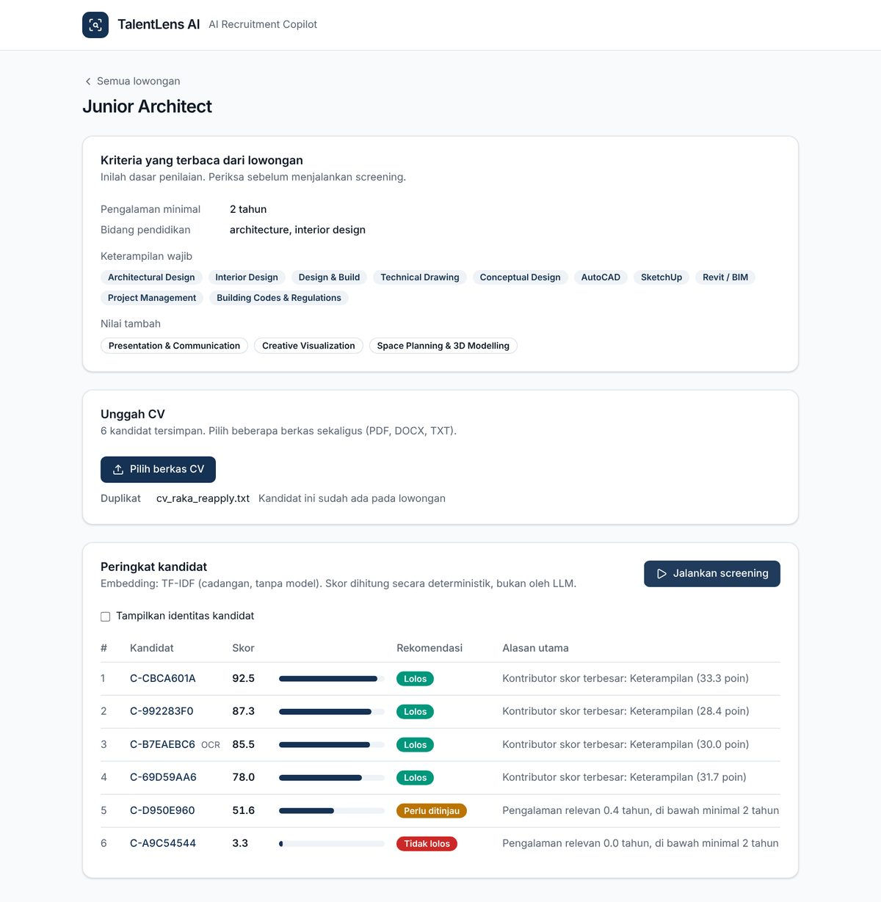
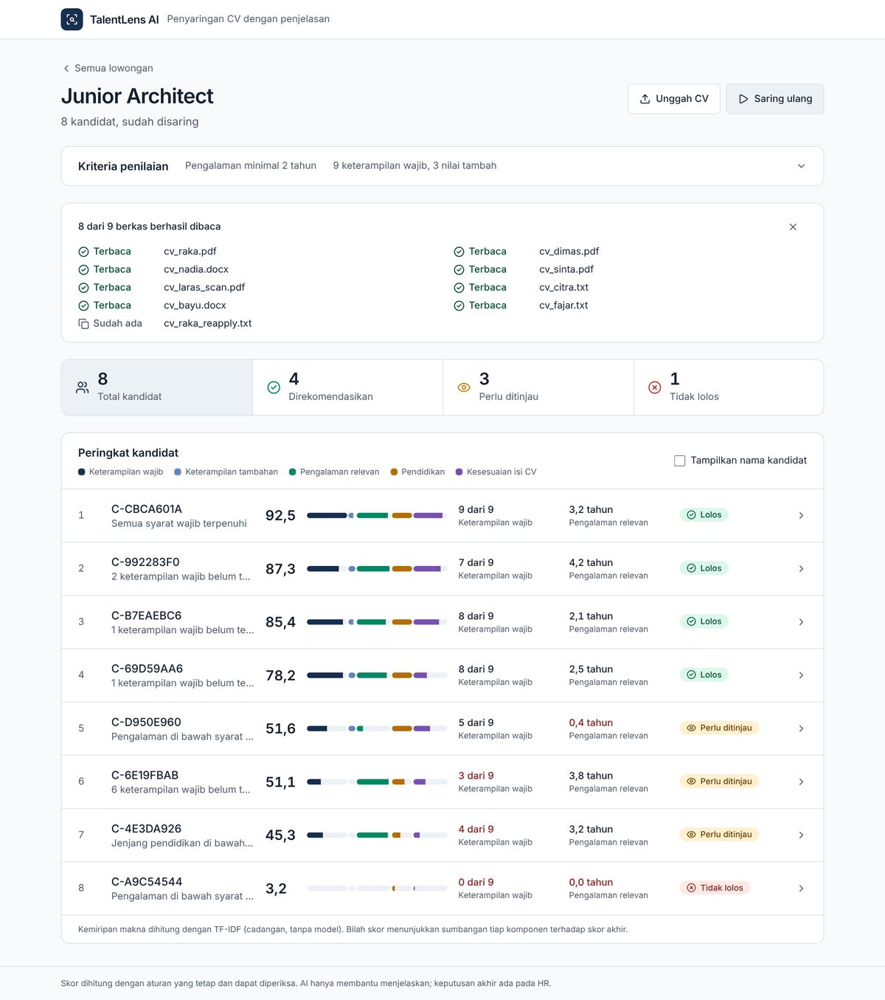
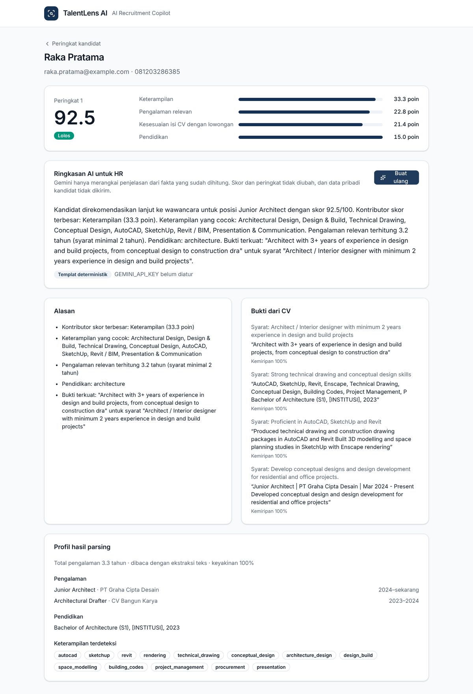
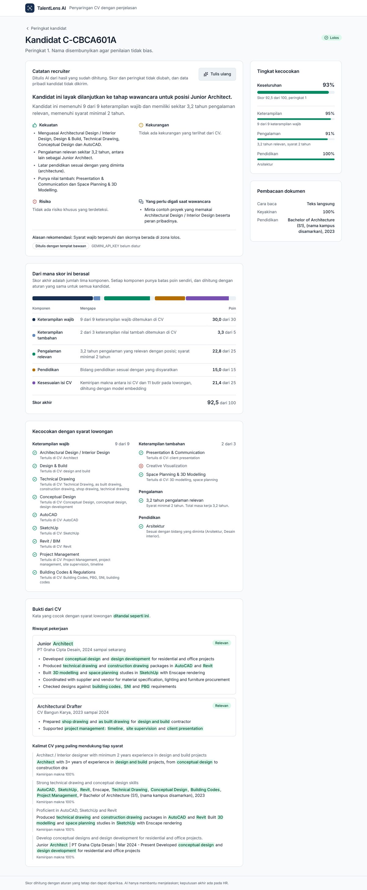

# Sprint Report 04 — Enterprise AI Demo Ready

**Tanggal:** 17 November 2026 · **Cabang Git:** `sprint-4` (dibuat dari `sprint-3`) · **Status:** selesai di lingkungan pembuatan; menunggu uji ulang dengan data perusahaan di mesin Product Owner

## Sprint Summary

Aplikasi berubah dari prototipe yang berjalan menjadi demo yang menjelaskan dirinya sendiri. Halaman
lowongan kini menampilkan ringkasan hasil dan peringkat dengan bilah susunan skor. Halaman kandidat
menampilkan catatan bergaya recruiter, asal setiap poin skor, kecocokan per syarat, dan CV dengan kata
kunci yang ditandai.

Algoritma penilaian, parser CV, embedding, pencocokan semantik, dan pipeline screening tidak diubah.
Tes snapshot dari Sprint 3 lolos tanpa perubahan, sehingga skor dan peringkat sama seperti sebelumnya.

Dua hal perlu diketahui. Prompt catatan recruiter yang baru belum pernah diuji terhadap API Gemini asli.
Peringkat lima CV perusahaan belum sah, karena pada uji Sprint 3 yang terunggah sebagai lowongan adalah
sebuah CV; kesalahan itu sekarang ditolak aplikasi, tetapi ujinya harus diulang.

## Completed Tasks

| # | Fokus pada spesifikasi | Hasil |
| --- | --- | --- |
| 1 | Enterprise UI/UX | Tiga halaman dibangun ulang: hierarki, jarak, tipografi, ikon, warna vonis, tata letak ponsel, serta keadaan memuat, kosong, berhasil, dan galat |
| 2 | AI Recruitment Summary | Catatan dengan susunan tetap: kesimpulan, kecocokan, kekuatan, kekurangan, risiko, fokus wawancara, alasan rekomendasi. Gemini dan templat mengisi susunan yang sama |
| 3 | Explainable AI | Panel "Dari mana skor ini berasal": lima baris dengan poin, batas poin, dan alasan, dijumlahkan menjadi skor akhir |
| 4 | Candidate Insight | "Tingkat kecocokan": keseluruhan, keterampilan, pengalaman, pendidikan, dalam persen dengan bilah |
| 5 | Keyword Highlight | Kata yang cocok ditandai pada riwayat pekerjaan dan kutipan CV; keterampilan yang tidak ditemukan dan syarat yang belum terpenuhi ditampilkan terpisah; tiap jabatan diberi label relevan, sebagian relevan, atau tidak dihitung |
| 6 | Dashboard Improvement | Ringkasan total, direkomendasikan, perlu ditinjau, tidak lolos; tiap angka juga menyaring daftar |
| 7 | Polish | Kerangka saat memuat, transisi ringan pada bilah dan baris, fokus keyboard, lencana dan ikon yang konsisten |
| 8 | Review | Tinjauan UI, aksesibilitas, dan kode; temuannya diperbaiki (lihat di bawah) |
| 9 | Testing | 89 tes backend lolos (dari 73); lint dan build frontend lolos; tes snapshot skor tidak berubah |

**Tambahan sebagai dependensi teknis (Sprint Policy):**

- Penolakan CV yang diunggah sebagai lowongan. [TDR-0021](tdr/0021-reject-cv-uploaded-as-job.md)
- Perbaikan `.env.example` dan nilai environment kosong (di-commit pada `sprint-3` setelah laporan sebelumnya).
- Prettier sebagai dependensi pengembangan, dengan skrip `npm run format`.

**Sesuai dan tidak sesuai dengan permintaan:**

- "Bonus Score" ditampilkan sebagai baris "Keterampilan tambahan", yaitu bagian dari komponen keterampilan. Rumus skor tidak punya komponen bonus tersendiri, dan menambahkannya akan mengubah peringkat.
- "Experience Score" dan "Education Score" memakai nilai komponen yang sama dengan yang dipakai untuk menilai.
- Panel penjelasan juga menampilkan "Kesesuaian isi CV", komponen yang ada di rumus tetapi tidak disebut di spesifikasi.

## Temuan review dan tindak lanjutnya

| Review | Temuan | Tindak lanjut |
| --- | --- | --- |
| UI | Laporan unggahan mendorong kepala halaman | Dipindah ke bawah kepala halaman, dapat ditutup |
| UI | Kriteria menyebut 10 keterampilan wajib, peringkat menyebut 9 | Syarat alternatif ("A / B") digabung di kedua tempat |
| UI | Baris peringkat menulis "semua syarat terpenuhi" padahal ada keterampilan wajib yang belum terlihat | Keterangan baris kini menyebut jumlahnya |
| UI | Di ponsel, tingkat kecocokan berada di paling bawah | Dipindah ke paling atas |
| UI | Nama bidang berbahasa Inggris dan penanda redaksi mentah (`[INSTITUSI]`) | Diterjemahkan dan diganti kalimat yang terbaca |
| Aksesibilitas | Warna komponen pendidikan berkontras 2,8 : 1 terhadap latarnya | Digelapkan menjadi di atas 3 : 1 |
| Aksesibilitas | Tombol utama setinggi 40 px | Menjadi 44 px |
| Aksesibilitas | Penanda kata kunci menandai potongan kata ("Architect" di dalam "Architecture") | Hanya kata utuh yang ditandai |
| Kode | Lowongan dengan judul bagian yang tidak baku akan dianggap CV | Daftar judul diperluas; tiga kasus diuji |
| Kode | Daftar peringkat memindai kata kunci yang tidak ditampilkan | Pemindaian dilewati pada daftar |

## Screenshot sebelum dan sesudah

| Halaman | Sebelum (Sprint 3) | Sesudah (Sprint 4) |
| --- | --- | --- |
| Peringkat |  |  |
| Rincian kandidat |  |  |

Tambahan: [kandidat yang perlu ditinjau](screenshots/sprint-4/sesudah-rincian-perlu-ditinjau.jpg),
[peringkat di ponsel](screenshots/sprint-4/sesudah-peringkat-ponsel.jpg),
[CV ditolak sebagai lowongan](screenshots/sprint-4/sesudah-cv-ditolak-sebagai-lowongan.jpg).

Semua tangkapan layar memakai CV sintetis, mode TF-IDF, dan catatan dari templat, karena lingkungan
pembuatan tidak dapat memuat model E5 maupun memanggil Gemini.

## Skill dan plugin Claude yang digunakan

| Skill | Dipakai untuk | Kontribusi nyata |
| --- | --- | --- |
| `frontend-design` | Arah desain sebelum menulis kode | Satu elemen utama (bilah susunan skor), token warna per komponen, larangan pola generik (label huruf kapital, kartu seragam, animasi di semua tempat), dan aturan penulisan teks antarmuka |
| `ui-design-review:ui-review` | Meninjau tangkapan layar hasil render (layar lebar dan 390 px) | Lima temuan UI pada tabel di atas |
| `design:accessibility-review` | Pemeriksaan WCAG 2.1 AA | Kontras 19 pasangan warna dihitung dari token; tiga temuan aksesibilitas pada tabel di atas |
| `engineering:code-review` | Meninjau perubahan Sprint 4 (keamanan, kinerja, ketepatan, keterawatan) | Dua temuan kode pada tabel di atas |

**Tidak digunakan, dan alasannya:**

- Plugin Figma, Vercel, Supabase, Cloudflare: proyek tidak punya berkas Figma dan tidak di-deploy.
- Agen `agentic-council` dan agen review lainnya: tidak dijalankan; tinjauan dilakukan langsung dengan tiga skill di atas.
- Skill proses `ui-consistency`: tidak dijalankan; konsistensi diperiksa lewat tinjauan UI.
- Skill yang tidak terkait (keuangan, hukum, pemasaran, media sosial, manufaktur, dan sejenisnya).

Batas tinjauan: tablet (768 px), mode gelap, navigasi keyboard penuh, dan pembaca layar tidak diuji.
Tinjauan kinerja terbatas pada pembacaan kode; tidak ada pengukuran Lighthouse atau profil.

## Modified Files

- Backend: `app/api/v1/jobs.py`, `app/schemas/screening.py`, `app/services/{hr_summary,matching,screening,store,taxonomy}.py`, `tests/test_hr_summary.py`, `tests/test_jobs_api.py`
- Frontend: `package.json`, `package-lock.json`, `src/app/{globals.css,layout.tsx,page.tsx}`, `src/app/jobs/[jobId]/page.tsx`, `src/app/jobs/[jobId]/candidates/[candidateId]/page.tsx`, `src/hooks/use-api.ts`, `src/lib/{api,labels,utils}.ts`, `src/components/{ai-summary,cv-upload,file-picker,job-criteria,page-shell,ranking-table,recommendation-badge,system-status}.tsx`, `src/components/ui/{badge,button,card}.tsx`
- Dokumentasi: `README.md`, `docs/ARCHITECTURE.md`, `docs/SCREENING.md`, `docs/tdr/README.md`

Sebagian berkas frontend hanya berubah formatnya karena Prettier.

## Added Files

- Backend: `app/services/match_breakdown.py`, `tests/test_match_breakdown.py`
- Frontend: `src/components/{cv-evidence,highlighted-text,match-breakdown,meter,score-composition,score-explainer,stat-strip}.tsx`, `src/components/ui/{empty-state,notice,skeleton}.tsx`
- Dokumentasi: `docs/SPRINT_REPORT_04.md`, `docs/tdr/0019` sampai `0022`, `docs/screenshots/sprint-4/` (7 gambar)

## Deleted Files

- `frontend/src/components/score-bar.tsx` (digantikan `meter.tsx` dan `score-composition.tsx`)

## Known Issues

- **Prompt catatan recruiter (keluaran JSON) belum diuji terhadap Gemini asli.** Bila model menjawab di luar format, yang tampil adalah templat dengan label penyebabnya.
- **Peringkat lima CV perusahaan belum sah dan kualitas pembacaan tiap CV belum diperiksa.**
- Rentang kalibrasi E5 baru diperiksa pada satu pasang kalimat.
- Pada mode TF-IDF, kemiripan bukti sering tampil 100%.
- Penanda kata kunci ikut menandai nama perusahaan yang memuat kata kunci.
- Alasan dari pipeline masih memakai titik desimal ("0.4 tahun"), karena teksnya bagian dari logika yang tidak boleh diubah; teks baru memakai koma.
- Lowongan yang salah unggah tidak dapat dihapus dari antarmuka.
- Tag sprint belum ada di GitHub (push tag ditolak); `docker compose up --build` belum dijalankan.

## Technical Debt

- Frontend tanpa tes otomatis; alurnya diverifikasi dengan skrip peramban sekali jalan.
- Keputusan HR (mengubah rekomendasi) dan audit bias dari PoC lama belum dibawa.
- Penjelasan dihitung ulang pada setiap permintaan, tanpa cache.
- Label bidang pendidikan dan nama komponen didefinisikan di frontend; taksonomi keterampilan masih berbahasa Inggris.
- Mode gelap belum ada.

## Risks

| Risiko | Dampak | Mitigasi |
| --- | --- | --- |
| CV perusahaan terbaca buruk oleh parser berbasis aturan | Peringkat dan penjelasan demo tidak masuk akal; penjelasan yang rinci justru memperjelas kesalahan baca | Ulangi uji dengan berkas lowongan yang benar hari ini; perbaikan parser butuh persetujuan karena menyentuh logika |
| Gemini menjawab di luar format JSON | Catatan selalu tampil dari templat | Uji satu kandidat; bila perlu, sesuaikan prompt |
| Waktu sampai Kamis 16.30 | Temuan dari data nyata tidak sempat diperbaiki | Uji data nyata didahulukan sebelum pekerjaan lain |
| CV asli atau kunci API masuk repositori publik | Kebocoran data | `backend/storage/` dan `.env` di-ignore; kunci yang pernah ditempel di percakapan sebaiknya diganti |

## Technical Decision Records

- [TDR-0019](tdr/0019-explanation-views-are-presentation-only.md): tampilan penjelasan dihitung terpisah dan tidak ikut menilai
- [TDR-0020](tdr/0020-one-note-shape-for-gemini-and-template.md): satu susunan catatan untuk Gemini dan templat
- [TDR-0021](tdr/0021-reject-cv-uploaded-as-job.md): CV ditolak saat diunggah sebagai lowongan
- [TDR-0022](tdr/0022-ui-system-for-explanation.md): satu bahasa visual untuk penjelasan skor

Tidak ada perubahan arsitektur. Satu modul ditambahkan di lapisan service, dan bentuk response
ringkasan berubah.

## Recommended Next Sprint

**Sprint 5: validasi data nyata dan gladi demo.**

1. Product Owner: `git pull` cabang `sprint-4`, hapus `backend/storage/state.json`, unggah berkas Vacancy, unggah lima CV, jalankan screening.
2. Periksa tiap CV pada halaman rincian: apakah jabatan, masa kerja, pendidikan, dan keterampilannya terbaca benar.
3. Buat catatan recruiter untuk satu kandidat dan pastikan labelnya "Ditulis oleh Gemini".
4. Berdasarkan temuan: perbaikan parser atau kalibrasi (butuh persetujuan), lalu skrip demo, penyelarasan slide presentasi, dan penggabungan ke `main`.

## Suggested Git Commit Message

```
feat: make the app demo-ready with explainable scores and a recruiter-style summary
```
